  
  
  

<b>Group chat, voice and DMs. No email, no password, no backend. Just your keys.</b> 
Every piece is self-hostable and swappable.

### The core

<table align="center">
  <tr>
    <td align="center" width="25%" valign="top">
       
      <a href="https://github.com/obelisk-app/obelisk"><b>Obelisk</b></a> 
      Nostr-native chat and voice client. The browser talks straight to relays.  
      
    </td>
    <td align="center" width="25%" valign="top">
       
      <a href="https://github.com/obelisk-app/obelisk-relay"><b>Obelisk Relay</b></a> 
      NIP-29 groups relay in Rust: roles, private groups, web-of-trust admission, a moderation console.  
      
    </td>
    <td align="center" width="25%" valign="top">
       
      <a href="https://github.com/obelisk-app/obelisk-sfu"><b>Obelisk SFU</b></a> 
      mediasoup voice SFU. Browsers sign in with their Nostr identity.  
      
    </td>
    <td align="center" width="25%" valign="top">
       
      <a href="https://github.com/obelisk-app/obelisk-agents"><b>Obelisk Agents</b></a> 
      Nostr bots and LLM agents for NIP-29 groups, plus an agent-friendly CLI.  
      
    </td>
  </tr>
</table>

Four small projects, one open protocol. Swap any of them out; the rest keep working.

### Around it

<table align="center">
  <tr>
    <td align="center" width="25%" valign="top">
       
      <a href="https://github.com/obelisk-app/obelisk-sky"><b>Obelisk Sky</b></a> 
      A 3D floating-island village that is an Obelisk client. Every channel is a house.  
      
    </td>
    <td align="center" width="25%" valign="top">
       
      <a href="https://github.com/obelisk-app/obelisk-apps"><b>Obelisk Apps</b></a> 
      Games shipped as Nostr events, run in a sandboxed iframe. Chain Reaction, Chess and more.  
      
    </td>
    <td align="center" width="25%" valign="top">
       
      <a href="https://github.com/obelisk-app/obelisk-menhir"><b>Obelisk Menhir</b></a> 
      Host a private chat server from your own computer, published through Tor, with one click.  
      
    </td>
    <td align="center" width="25%" valign="top">
       
      <a href="https://github.com/obelisk-app/obelisk-design"><b>Obelisk Design</b></a> 
      The shared design system, security workflows and development style.  
      
    </td>
  </tr>
</table>

### Walk around it

Obelisk Sky lays a relay's channels out as a floating village. <a href="https://sky.obelisk.ar/app">Come in</a>.

### Also

- [**blossom-server**](https://github.com/obelisk-app/blossom-server): a Blossom media server on Deno 2, Hono and LibSQL (fork of [hzrd149/blossom-server](https://github.com/hzrd149/blossom-server))
- [**obelisk-kindle-lite**](https://github.com/obelisk-app/obelisk-kindle-lite): a Kindle-friendly Obelisk Paper client
- [**obelisk-classic**](https://github.com/obelisk-app/obelisk-classic): the original centralized stack, retired July 28, 2026

 
Built on <a href="https://github.com/nostr-protocol/nips">Nostr</a>.

